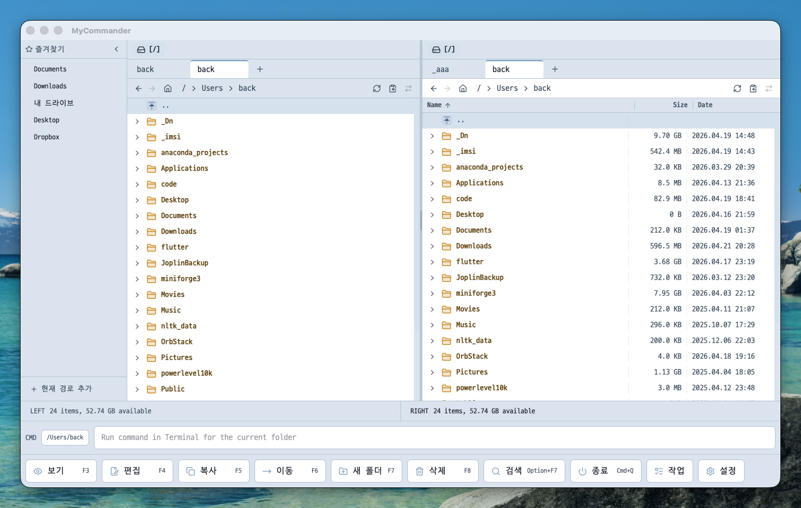

# MyCommander

Tauri v2 + React 19 + TypeScript + Rust로 만든 듀얼 패널 데스크톱 파일 매니저입니다.



## 주요 기능

- 좌우 패널, 탭, 탐색 이력, 즐겨찾기, 최근·자주 쓰는 위치
- 파일·폴더 생성, 복사, 이동, 삭제, 일괄 이름 변경, ZIP 생성·해제
- 고급 검색, 현재 폴더 필터, brief / detailed 보기, Git 상태 표시
- 빠른 미리보기: 이미지·비디오·PDF·텍스트·Markdown·HTML·Excel·SQLite·Word·Jupyter Notebook·PowerPoint·HWPX
- 폴더 비교·동기화, 디렉터리 크기 추정·정확 계산·캐시
- 패널 간·앱 외부 드래그 드롭, Command Palette, 마지막 이름 변경·이동 Undo
- 글꼴·패널 비율·창 크기 설정, 자동 테마, 창 상태 복원

## 개발 환경과 실행

- Node.js 22 계열 최신 버전과 npm. CI도 Node.js 22를 사용합니다.
- Rust stable
- macOS: Xcode Command Line Tools
- Windows: Visual Studio C++ Build Tools
- Linux: WebKitGTK 등 Tauri v2 빌드 의존성

저장소 루트에서 실행합니다.

```bash
npm ci
npx lefthook install
npm run tauri dev
```

`npm ci`는 저장된 `package-lock.json`에 맞춰 설치합니다. 의존성을 바꿀 때는 `npm install`을 사용하고 lockfile 변경도 검토합니다.

브라우저에서 화면만 확인하려면 `npm run dev`를 사용합니다. 기본 주소는 `http://127.0.0.1:1420`이며, 실제 파일 작업 등 Tauri 기능은 데스크톱 앱에서 확인해야 합니다.

## 기본 사용법

| 키 | 동작 |
|---|---|
| `Tab` | 활성 패널 전환 |
| `F3` / `F4` | 보기 / 편집 |
| `Shift+F4` / `F7` | 새 파일 / 새 폴더 |
| `F5` / `F6` / `F8` | 복사 / 이동 / 삭제 |
| `F11` | 폴더 동기화 |
| `Cmd/Ctrl+F` | 검색 |
| `Cmd/Ctrl+Shift+P` | Command Palette |
| `Cmd/Ctrl+F1` / `Cmd/Ctrl+F2` | brief / detailed 보기 |
| `/` | 현재 폴더 필터 |
| `Space` | 선택한 디렉터리 크기 계산 시작·취소 |

PDF·PPTX 미리보기는 왼쪽 썸네일과 현재 페이지를 표시합니다. 화살표·PageUp/PageDown으로 넘기고 Home/End로 처음·끝으로 이동합니다. PPTX의 차트·동영상·일부 이미지는 자리 표시로 보이며, 도구 줄에서 텍스트 보기로 전환할 수 있습니다.

폴더 크기는 기호 없음(정확), `≥`(접근 불가 항목을 뺀 하한값), `+`(계산 중·일부 읽기 실패), `~`(추정), `-`(미확인)로 구분합니다. 계산하면 하위 두 단계 폴더의 크기도 저장합니다. 1024 단위의 겉보기 크기를 표시하므로 Finder의 디스크 사용량과 다를 수 있으며, 다른 볼륨과 symlink 대상은 합계에서 제외합니다.

검색은 정규식, 숨김 파일, 파일 유형, 확장자, 크기, 수정일 조건을 지원합니다. 검색 결과에서도 복사·이동·삭제할 수 있습니다.

드래그 드롭은 다음과 같이 동작합니다.

- 반대 패널이나 앱 밖에서 드롭하면 대상 폴더로 복사합니다.
- 같은 패널에서는 파일을 복사하고, 폴더만 선택한 경우에는 이동합니다.
- 이름이 겹치면 확인 다이얼로그에서 처리 방법을 선택합니다.

짧은 결과는 토스트로, 긴 작업은 진행 다이얼로그로 표시합니다. 작업 센터에서 작업 이력·실패 내역을 확인하고 재시도할 수 있습니다. 파일 작업 후 같은 폴더를 보는 양쪽 패널이 함께 갱신됩니다.

## 개발 명령

| 용도 | 명령 |
|---|---|
| 앱 개발 모드 | `npm run tauri dev` |
| 화면 개발 서버 | `npm run dev` |
| 타입 검사 | `npm run typecheck` |
| 관련 프런트엔드 테스트 | `npm run test -- <테스트 파일 또는 이름>` |
| 프런트엔드 전체 검사 | `npm run verify:frontend` |
| Rust 전체 검사 | `npm run verify:rust` |
| Tauri 명령·권한 연결 검사 | `npm run verify:tauri-commands` |
| 전체 검사 | `npm run verify` |
| 릴리즈 검사와 macOS 앱 빌드 | `npm run verify:release` |

변경 범위별 검사 기준과 Git 훅의 실제 동작은 [AGENTS.md](AGENTS.md#검증)에 정리되어 있습니다.

## 빌드와 릴리즈

로컬 앱 패키지는 `npm run tauri build`로 빌드합니다. 결과는 `src-tauri/target/release/bundle/`에 생성됩니다.

릴리즈는 기능 변경 커밋과 버전 변경 커밋을 분리하고, 커밋·태그·푸시는 사용자 승인 범위 안에서 수행합니다.

1. 기능 변경을 검증하고 커밋합니다.
2. `npm version <patch|minor|major> --no-git-tag-version`으로 버전을 올립니다.
3. `npm run verify:release`로 버전 일치, 전체 검사, 앱 빌드를 확인합니다. 현재 이 명령은 `--bundles app`을 사용하므로 macOS에서 실행합니다.
4. `package.json`, `package-lock.json`, `src-tauri/tauri.conf.json`, `src-tauri/Cargo.toml`, `index.html`을 검토해 버전 커밋에 포함합니다. Cargo 실행으로 `src-tauri/Cargo.lock`의 앱 버전이 바뀌었다면 함께 포함합니다.
5. 버전 커밋에 annotated tag `v<version>`을 생성합니다. 기존 릴리즈 태그는 재사용하거나 이동하지 않습니다.
6. `git push origin main` 다음에 해당 태그를 푸시합니다. `npm run release:push`를 사용할 때도 먼저 대상 브랜치와 태그를 확인합니다.

`version-sync.cjs`가 npm 버전을 Tauri 설정·창 제목, Cargo manifest, HTML 제목에 반영합니다. npm의 `version` 스크립트는 Tauri 설정·Cargo manifest·`index.html`을 자동으로 스테이징하므로, 버전 업데이트 후 `git diff --cached`도 확인해야 합니다.

GitHub 릴리즈는 `v*` 태그 푸시 또는 수동 워크플로 실행으로 시작됩니다. CI와 플랫폼별 빌드 후 draft release의 산출물 검사를 통과하면 공개합니다. 자세한 실제 절차는 [release.yml](.github/workflows/release.yml)과 [산출물 검사 스크립트](scripts/verify-release-assets.sh)를 기준으로 합니다.

## 문제 해결

- **1420 포트 충돌:** `lsof -ti tcp:1420`으로 확인하고, 앱 개발 서버로 확인된 프로세스만 종료합니다.
- **Tauri 명령 권한 오류:** `npm run verify:tauri-commands`로 등록·permission·capability 연결을 확인합니다.
- **macOS 휴지통 이동 권한 오류:** 시스템 설정 → 개인정보 보호 및 보안에서 MyCommander의 파일 및 폴더 접근과 자동화의 Finder 권한을 확인합니다. 파일 자체의 권한도 확인해야 합니다.
- **macOS 잠자기 후 화면 고착:** 자동 복구 코드가 동작합니다. 반복되면 [useRendererRecovery.ts](src/hooks/useRendererRecovery.ts)를 확인합니다.
- **Windows에서 Git 표시 누락:** Git이 PATH에 있는지 확인합니다. Git이 없으면 상태 표시 없이 동작합니다.
- **Rust 산출물 용량 증가:** 실제 정리가 필요할 때만 `cargo clean --manifest-path src-tauri/Cargo.toml`을 실행합니다. 이후 다시 컴파일해야 합니다.

## 문서 안내

| 문서 | 내용 |
|---|---|
| [CLAUDE.md](CLAUDE.md) | 구현 구조와 유지해야 할 설계 정책 |
| [AGENTS.md](AGENTS.md) | 작업·질문·검증·커밋 규칙 |
| [TASKS.md](TASKS.md) | 진행 상황, 최근 검사 결과, 다음에 할 일 |
